# homey-dash

Ein schnelles, selbst gehostetes Dashboard für **Homey Pro**. Es bietet sieben Themes und vier Ansichten, darunter einen isometrischen Grundriss. Es läuft auf Handy, Tablet und Desktop, die Oberfläche gibt es auf Deutsch und Englisch.

Ein kleines Gateway behält den Homey-API-Key auf deinem Server. Der Browser sieht ihn nie, und das Gateway reicht nur eine kurze Liste erlaubter Aktionen weiter.

[English version](README.md) · [Demo ausprobieren](#in-30-sekunden-ausprobieren) · [Installation](#installation)

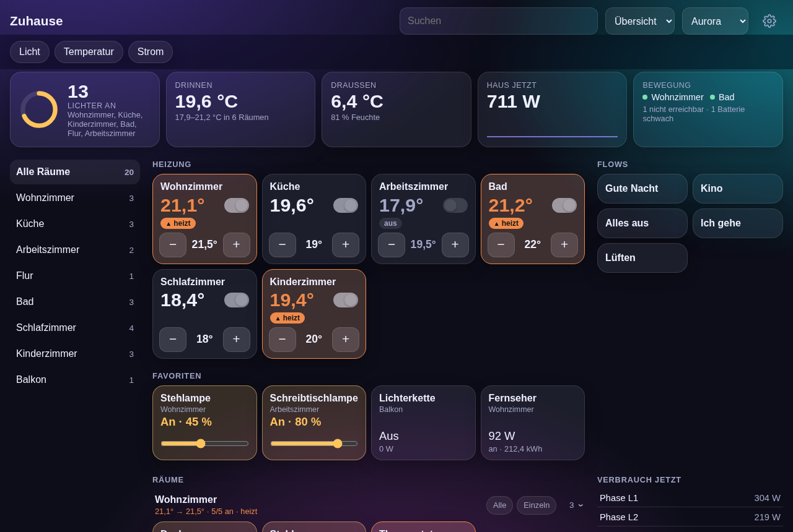

| Grundriss | Räume (Handy) | Standard (Handy) |
|---|---|---|
| 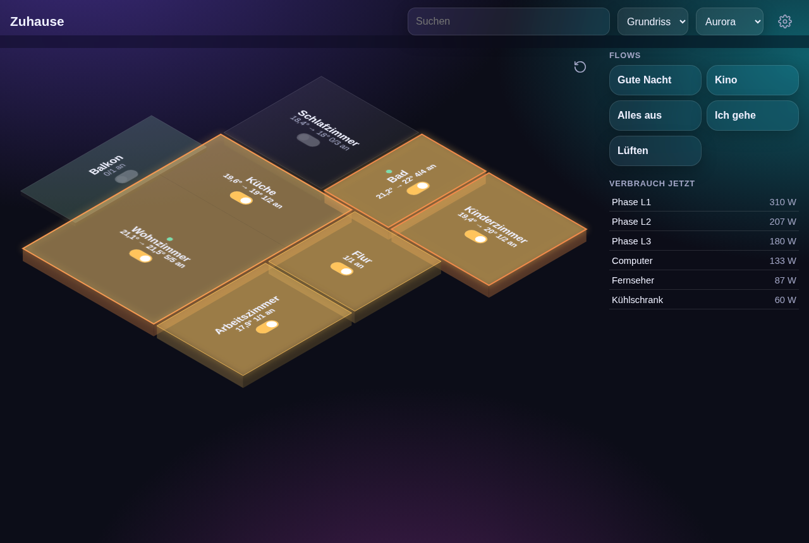 | 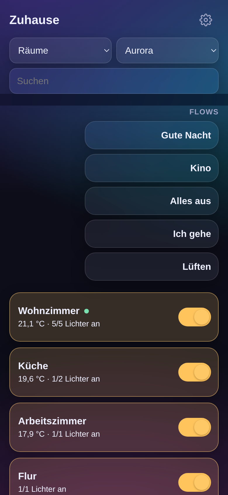 | 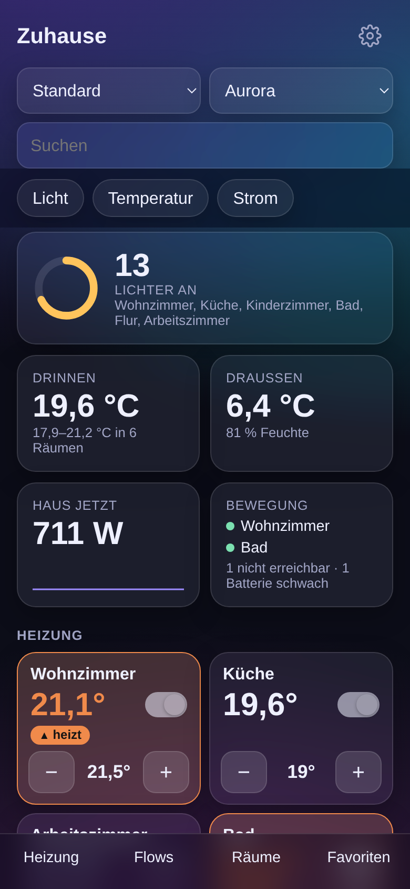 |

### Themes

| Standard | Omarchy | Aurora | Klar |
|---|---|---|---|
| 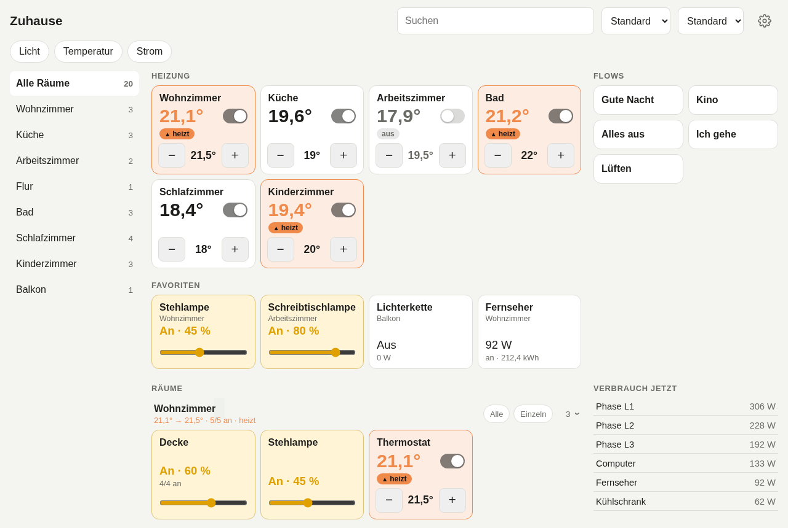 | 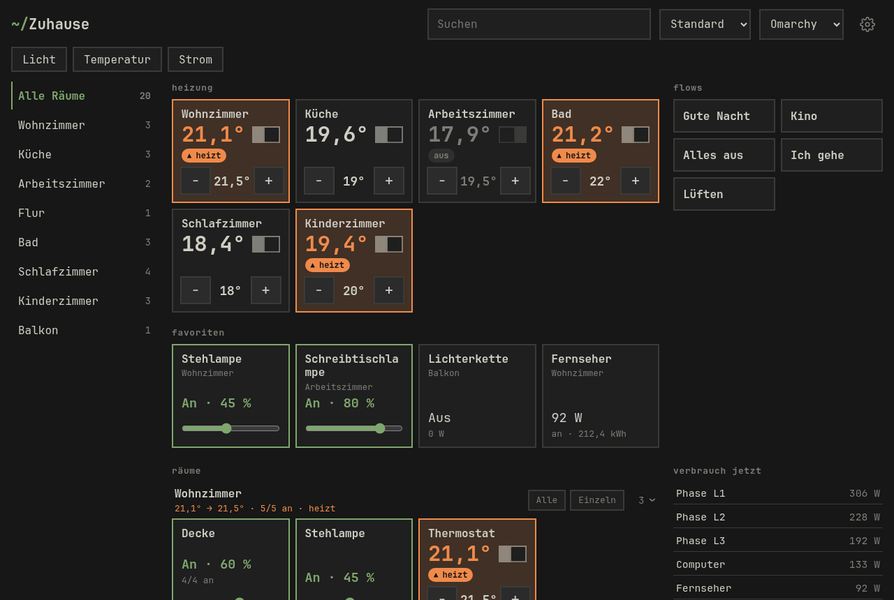 | 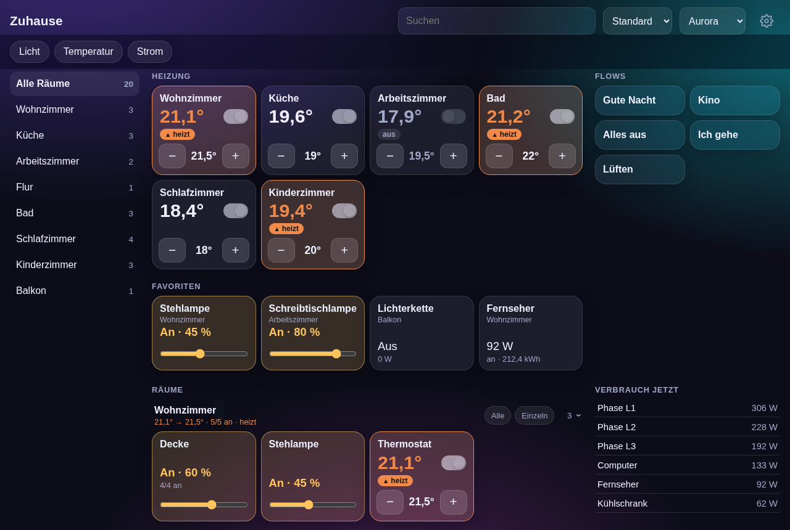 | 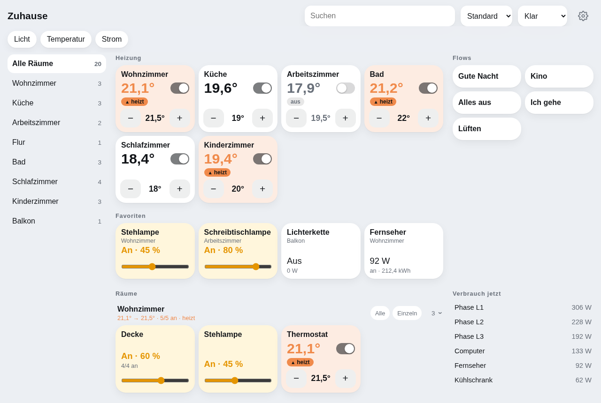 |
| **Papier** | **Nacht** | **Bento** | |
| 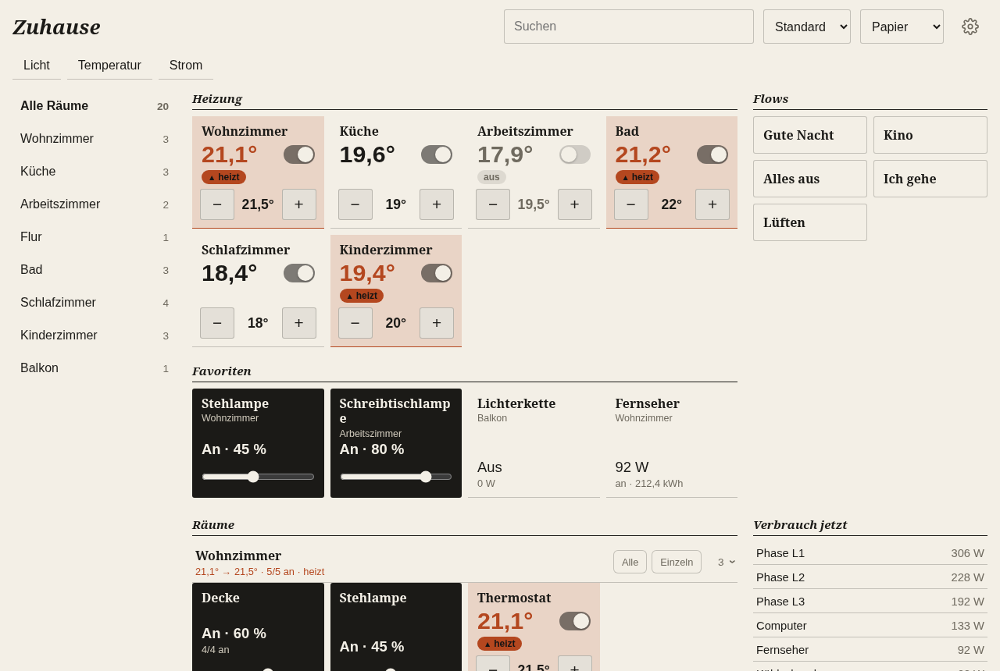 | 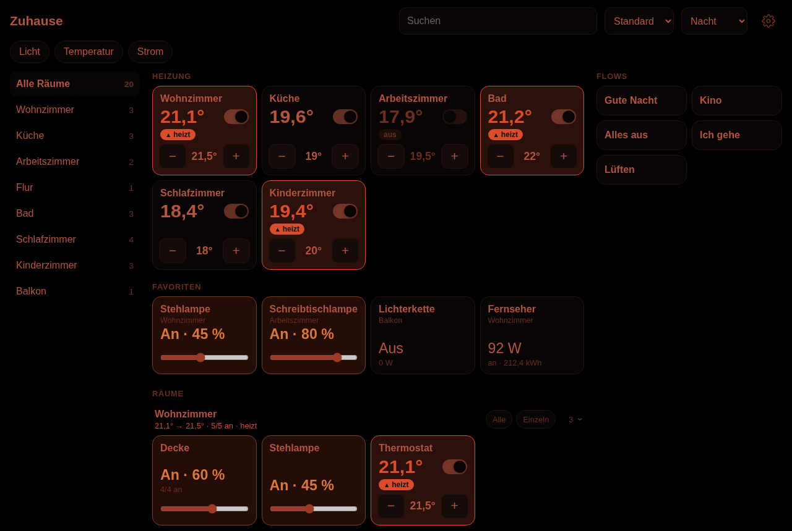 | 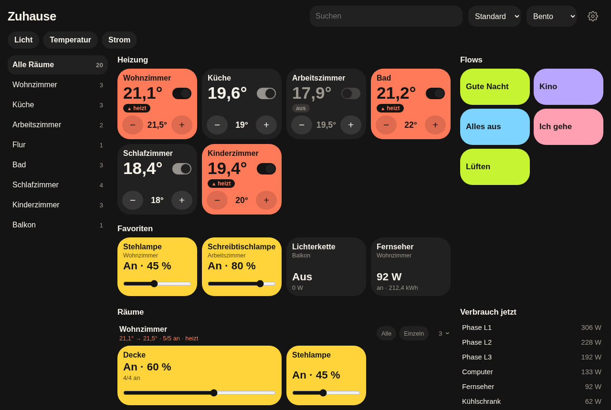 | |

## Funktionen

- **Vier Ansichten:**
  - **Standard** zeigt alle Geräte nach Raum.
  - **Übersicht** ergänzt oben einen animierten Info-Block: Lichter an, Temperatur drinnen und draußen, Hausverbrauch, Bewegung und Warnungen.
  - **Räume** zeigt eine Karte je Raum mit Schalter für alle Lichter.
  - **Grundriss** zeigt die Wohnung isometrisch. Räume leuchten, zeigen ihre Temperatur und haben je einen eigenen Lichtschalter.
- **Heizung:** Thermostate zeigen Ist- und Zieltemperatur. Das Ziel stellst du mit −/+ in 0,5°-Schritten ein, die Regelung lässt sich an- und ausschalten. Orange heißt: Der Raum heizt gerade wirklich.
- **Lampengruppen:** Mehrere Lampen, etwa Deckenspots, erscheinen als eine Kachel.
- **Favoriten und Flows:** Es gelten deine Homey-Favoriten. Favorisierte Flows mit Start-Auslöser erscheinen als Knöpfe.
- **Einstellungen je Konto:** Jedes Konto hat sein eigenes Theme, seine Ansicht und seine Sprache.
- **Schlank:** Kein Build-Schritt, keine Abhängigkeiten. Das Gateway nutzt nur die Python-Standardbibliothek, die Webapp ist reines HTML, CSS und JS.

## Sicherheitsmodell

Nur das Gateway spricht mit dem Homey. Es leitet einen Aufruf nur weiter, wenn alle diese Bedingungen erfüllt sind:

| Was | Erlaubt |
|---|---|
| Schalten und Dimmen | Geräte der Klasse *Licht* und Geräte-IDs aus `data/allow.json` |
| Thermostate | Regelung an/aus und Zieltemperatur, begrenzt auf 15–25 °C |
| Flows | Nur Homey-Favoriten des Kontos, und nur Flows mit Start-Auslöser |
| Alles andere | Nur lesen, und nur ausgewählte Fähigkeiten (keine Einstellungen, Notizen oder Treiberdaten) |

Steckdosen sind standardmäßig **nicht** schaltbar. An einer Steckdose kann ein Server, ein Kühlschrank oder eine Bewässerungspumpe hängen. Trag eine Steckdose nur dann in `allow.json` ein, wenn das Schalten vom Dashboard aus unbedenklich ist.

Weitere Schutzmaßnahmen:
- Passwörter werden als PBKDF2-Hash gespeichert.
- Nach 5 Fehlversuchen ist die IP 15 Minuten gesperrt.
- Das Sitzungs-Cookie ist HttpOnly, Secure und SameSite=Strict.
- Schreibende Anfragen brauchen einen eigenen Header und eine passende Origin, das schützt vor CSRF.
- Die Seite sendet eine strenge Content-Security-Policy.

## In 30 Sekunden ausprobieren

Die Demo nutzt eine erfundene Wohnung und kommt ohne Homey und ohne Anmeldung aus:

```bash
git clone https://github.com/maTzko13/homey-dash.git && cd homey-dash
HOMEY_DASH_DEMO_LANG=de python3 gateway/gateway.py demo     # Python 3.11+
```

Dann <http://127.0.0.1:8080> öffnen.

## Installation

Voraussetzungen:
- Ein **Homey Pro (Early 2023)** mit lokaler API. Andere Modelle sind ungetestet.
- Docker oder Python 3.11+.
- Ein Reverse Proxy mit HTTPS, es sei denn, du nutzt das Dashboard nur im eigenen Netz mit `allow_http`.

### 1. API-Key anlegen

In der Homey-Webapp (<https://my.homey.app>) unter **Einstellungen → API-Schlüssel → Neuer API-Schlüssel**. Vergib genau diese Rechte:

| Recht | Wofür |
|---|---|
| Geräte ansehen / `homey.device.readonly` | Geräte und Werte lesen |
| Geräte steuern / `homey.device.control` | Lichter schalten, Thermostate stellen |
| Zonen ansehen / `homey.zone.readonly` | Räume |
| Flows ansehen / `homey.flow.readonly` | Namen der Lieblings-Flows |
| Flows starten / `homey.flow.start` | Flow-Knöpfe |
| Benutzer ansehen / `homey.user.readonly` | Deine Favoriten |

Mehr Rechte braucht das Dashboard nicht. Es muss nie Flows, Apps oder Einstellungen ändern.

### 2. Gateway starten

```bash
mkdir -p data && chmod 700 data
cp examples/config.json data/            # "homey_address" auf die IP deines Homey setzen
nano data/apikey && chmod 600 data/apikey  # API-Key einfügen
docker compose up -d --build
docker compose exec homey-dash python3 /app/gateway/gateway.py adduser alice
```

`adduser` fragt nach einem Passwort mit mindestens 12 Zeichen. Das Konto nutzt die Favoriten des Homey-Eigentümers. Für die Favoriten eines anderen Homey-Benutzers hängst du `--homey-user <id>` an.

Der Container lauscht auf `127.0.0.1:8080`. Davor gehört dein Reverse Proxy, zum Beispiel Caddy:

```
home.example.com {
    reverse_proxy 127.0.0.1:8080
}
```

Läuft der Proxy in Docker oder auf einem anderen Rechner, trag sein Netz in `trusted_proxies` ein. Sonst sieht die Sperre nach Fehlversuchen nicht die echten Client-Adressen.

Ohne Docker startest du das Gateway mit `HOMEY_DASH_DATA=./data python3 gateway/gateway.py serve`.

## Konfiguration

Einstellungen stehen in `data/config.json`. Jeden Schlüssel kannst du auch als Umgebungsvariable `HOMEY_DASH_<SCHLÜSSEL>` setzen, zum Beispiel `HOMEY_DASH_HOMEY_ADDRESS=192.168.1.20`.

| Schlüssel | Vorgabe | Bedeutung |
|---|---|---|
| `homey_address` | – | IPv4-Adresse deines Homey. Das Gateway verbindet sich per HTTPS und prüft das Zertifikat auf `<ip-mit-strichen>.homey.homeylocal.com`. Das funktioniert auch, wenn dein DNS (Pi-hole, AdGuard) den Namen als Rebind sperrt. |
| `homey_url` | – | Alternative zu `homey_address`: eine volle Basis-URL wie `http://192.168.1.20` |
| `allow_http` | `false` | Anmeldung ohne HTTPS erlauben. Nur im eigenen Netz ohne Proxy nutzen. |
| `trusted_proxies` | Docker-Netze, localhost | Netze, die `X-Forwarded-For` setzen dürfen |
| `listen`, `port` | `0.0.0.0`, `8080` | Adresse, auf der das Gateway lauscht |
| `session_days` | `90` | Wie lange eine Anmeldung gilt |
| `outdoor_device` | – | Geräte-ID für „Draußen“ in der Übersicht. Ohne Angabe gilt das erste Gerät mit *Wetter/Außen* im Namen. |
| `power_devices` | – | Geräte-IDs, deren Leistung „Haus jetzt“ ergibt, etwa die drei Phasen eines Zählers |
| `power_zone` | `verteiler\|zähler\|meter\|…` | Wenn `power_devices` leer ist: alle Leistungsmesser in Zonen, auf die dieser reguläre Ausdruck passt |

### Datendateien (alle optional)

Vorlagen liegen in [`examples/`](examples/).

| Datei | Inhalt |
|---|---|
| `allow.json` | Weitere Geräte-IDs, die schaltbar sein sollen, etwa eine bestimmte Steckdose |
| `groups.json` | Lampengruppen: `[{"id": "wz-decke", "name": "Decke", "members": ["<Geräte-ID>", …]}]` |
| `order.json` | Reihenfolge der Räume als Liste von Zonennamen. Nicht genannte Zonen folgen in Homey-Reihenfolge. |
| `floorplan.json` | Grundriss, siehe unten |

Geräte-IDs findest du in den Homey Developer Tools (<https://tools.developer.homey.app>, *Devices*). Angemeldet kannst du sie auch aus `GET /api/state` lesen.

### Grundriss

`floorplan.json` beschreibt die Räume als Polygone in beliebiger Einheit, zum Beispiel Zentimetern. Verwende deine eigenen Zonennamen:

```json
{
  "rooms": [
    {"zone": "Schlafzimmer", "poly": [[900, 0], [1350, 0], [1350, 450], [900, 450]]},
    {"zone": "Balkon", "outdoor": true, "poly": [[250, -260], [850, -260], [850, 0], [250, 0]]},
    {"poly": [[0, 0], [900, 0], [900, 600], [0, 600]],
     "parts": [{"zone": "Wohnzimmer", "poly": [[0, 0], [600, 0], [600, 600], [0, 600]]},
               {"zone": "Küche", "poly": [[600, 0], [900, 0], [900, 600], [600, 600]]}]}
  ]
}
```

- Die Polygone sollten rechtwinklig sein.
- `outdoor` zeichnet eine flachere Platte.
- `parts` teilt eine Platte auf mehrere Räume auf, etwa bei offener Wohnküche.
- `at: [x, y]` legt den Beschriftungspunkt fest, das hilft bei L-förmigen Räumen.
- Der Knopf ⟲ dreht den Grundriss, die Drehung merkt sich jedes Gerät.

## Omarchy-Anbindung (optional)

Mit [Omarchy](https://omarchy.org) folgt das Theme **Omarchy** deinem Desktop-Theme. Bei jedem Theme-Wechsel meldet ein Hook die Farben an das Dashboard:

```bash
# Auf dem Server: Token für diesen PC erzeugen (wird nur einmal ausgegeben)
docker compose exec homey-dash python3 /app/gateway/gateway.py token mein-laptop alice \
  | tr -d '\n' | secret-tool store --label="homey-dash Token" service homey-dash user "$(hostname)"
# Auf dem PC
install -m 755 plugin/homey-theme-sync ~/.local/bin/
install -m 755 plugin/theme-set.hook ~/.config/omarchy/hooks/theme-set.d/homey-dash
mkdir -p ~/.config/homey-dash && echo https://home.example.com > ~/.config/homey-dash/url
```

Der erste Befehl setzt voraus, dass Server und PC derselbe Rechner sind. Sonst führst du den `token`-Befehl per SSH aus und leitest die Ausgabe auf dem PC in `secret-tool`. [`plugin/homey-dash.lua`](plugin/homey-dash.lua) ist eine Hyprland-Fensterregel, die das Dashboard als schwebendes Webapp-Fenster öffnet.

Einen Token widerrufst du mit `gateway.py revoke mein-laptop`.

## API

Die Endpunkte sind in der [englischen README](README.md#api) beschrieben.

## Entwicklung

- `python3 gateway/gateway.py demo` startet die erfundene Wohnung.
- `?theme=…&layout=…&lang=…` zeigt eine Kombination, ohne sie zu speichern.
- `tools/screenshots.sh` erzeugt `docs/screenshots/` mit Chromium headless neu.
- Alle Texte der Oberfläche stehen in [`web/i18n.js`](web/i18n.js). Für eine neue Sprache kopierst du dort einen Block.
- Die Kommentare im Code sind deutsch. Issues und Pull Requests sind auf Deutsch oder Englisch willkommen.

## Hinweis

Dies ist ein unabhängiges Projekt. Es steht in keiner Verbindung zu Athom B.V., dem Hersteller von Homey, und wird von Athom weder unterstützt noch empfohlen. „Homey“ ist eine Marke von Athom.

## Lizenz

[MIT](LICENSE)
