# homey-dash

A fast, self-hosted dashboard for **Homey Pro**. You get seven themes and four views, including an isometric floor plan. It works on phone, tablet and desktop. The UI is available in English and German.

A small gateway keeps the Homey API key on your server. The browser never sees the key, and the gateway forwards only a short whitelist of actions.

[Deutsche Fassung](README.de.md) · [Try the demo](#try-it-in-30-seconds) · [Install](#install)

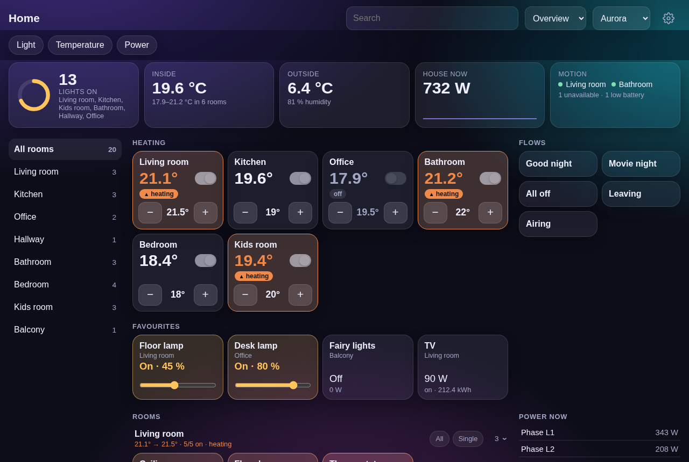

| Floor plan | Rooms (phone) | Standard (phone) |
|---|---|---|
| 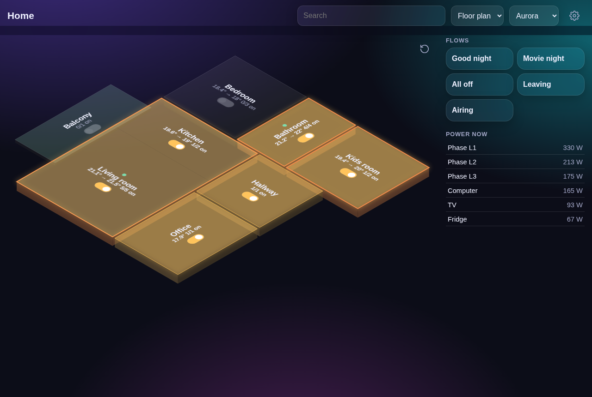 | 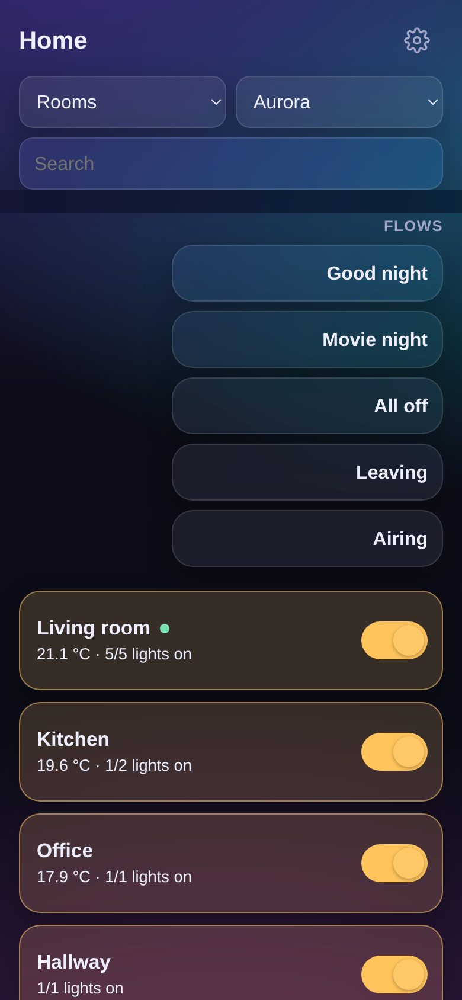 | 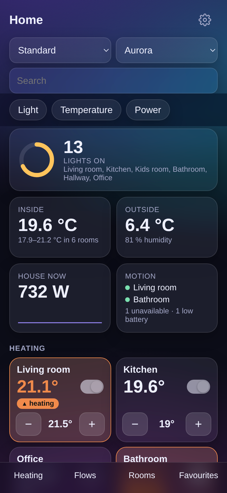 |

### Themes

| Default | Omarchy | Aurora | Clear |
|---|---|---|---|
| 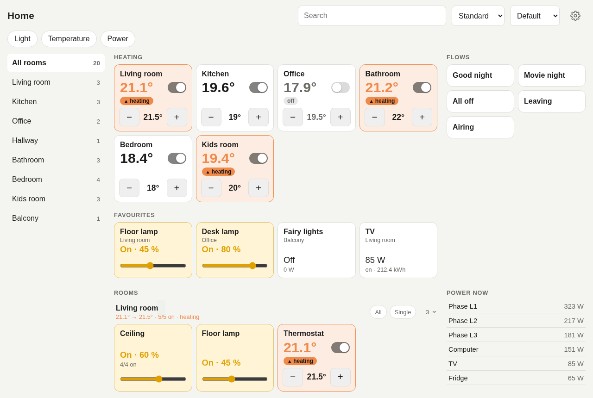 | 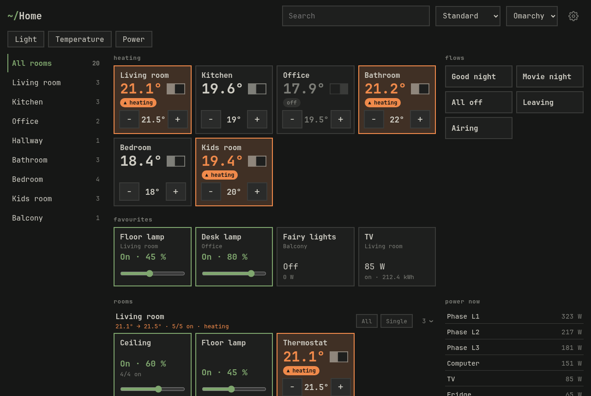 | 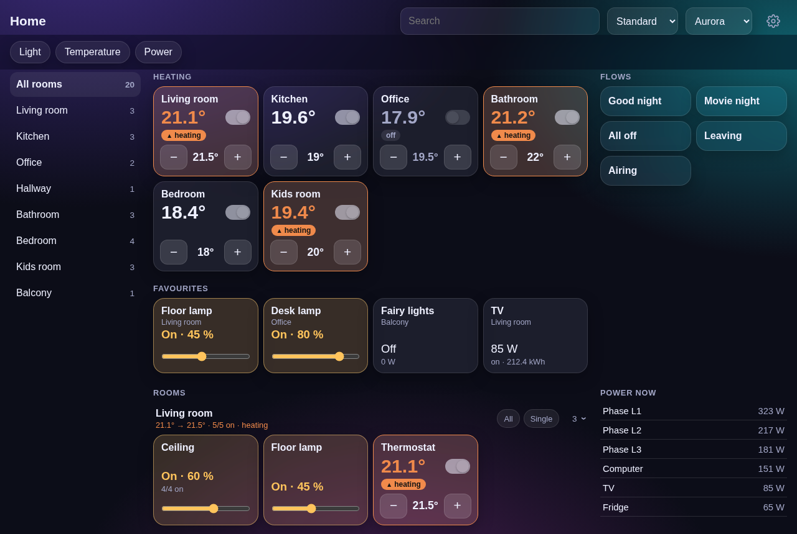 | 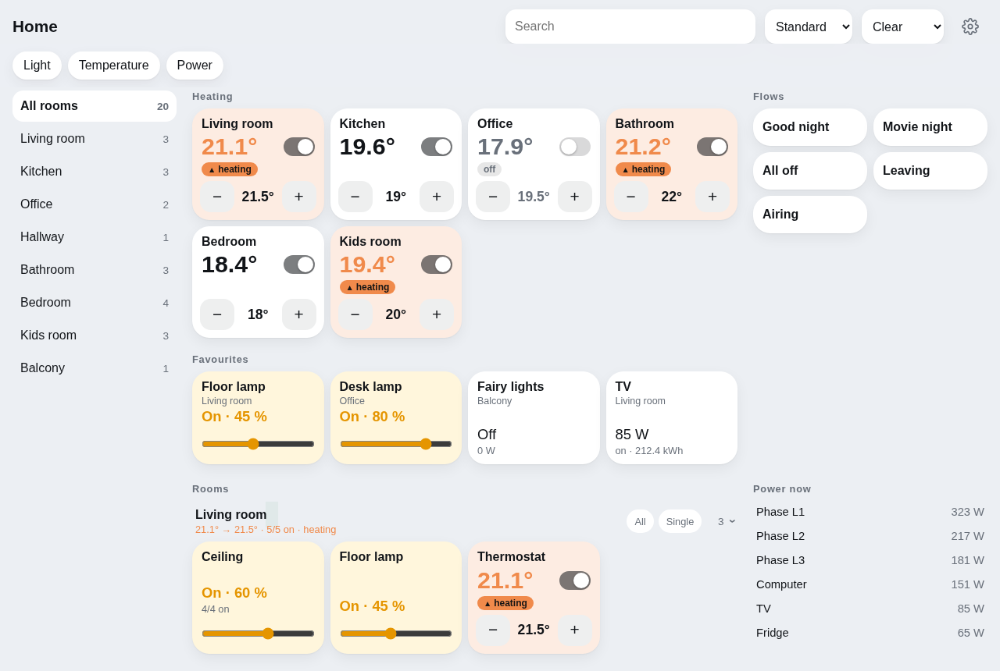 |
| **Paper** | **Night** | **Bento** | |
| 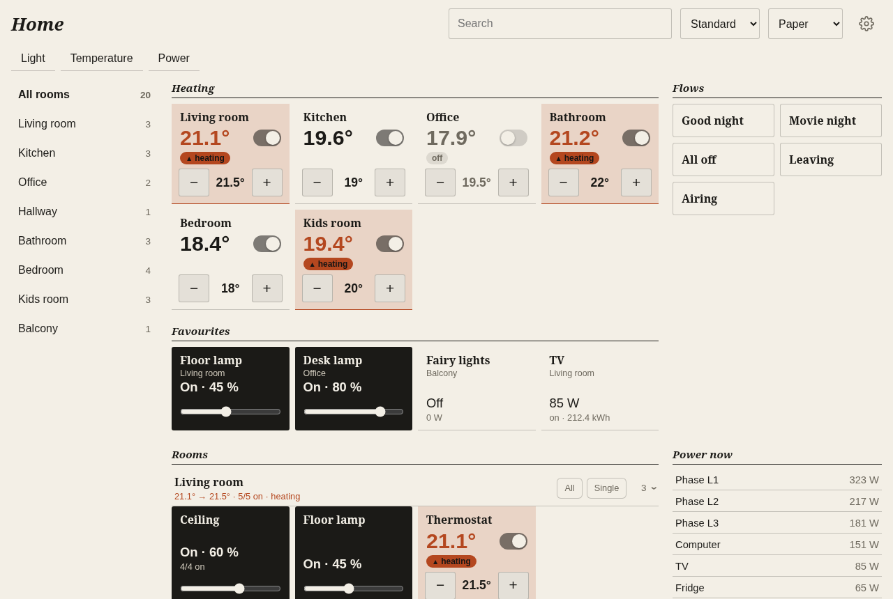 | 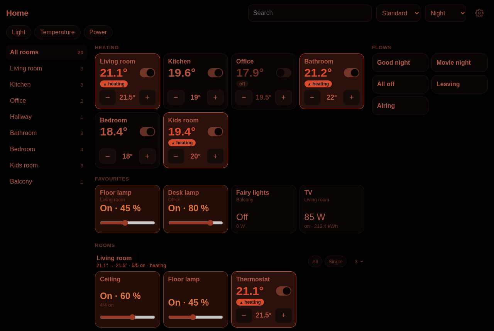 | 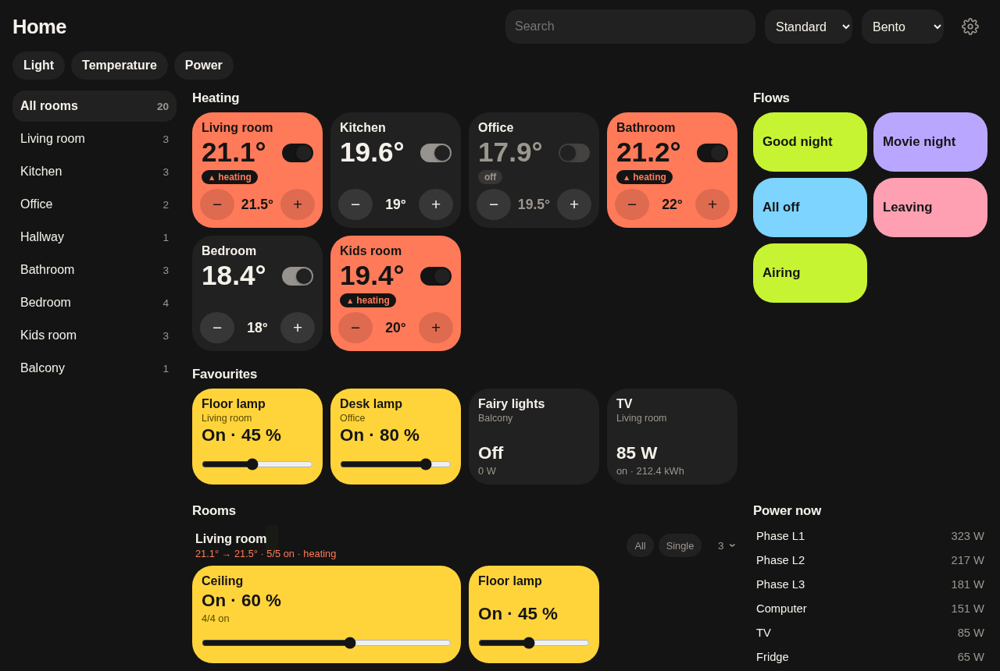 | |

## Features

- **Four views:**
  - **Standard** lists all devices by room.
  - **Overview** adds an animated info block on top: lights on, temperature inside and outside, house power, motion and warnings.
  - **Rooms** shows one card per room with a switch for all its lights.
  - **Floor plan** is an isometric view of your home. Rooms light up and show their temperature, and each room has its own light switch.
- **Heating:** Thermostats show the current and target temperature. You can change the target with −/+ in 0.5° steps and turn the thermostat's control on or off. Orange means a room is actually heating right now.
- **Lamp groups:** Several lamps, such as ceiling spots, can appear as one tile.
- **Favourites and flows:** The dashboard uses your Homey favourites. Favourite flows that have a start trigger appear as buttons.
- **Per-account settings:** Each account keeps its own theme, view and language.
- **Light footprint:** No build step and no dependencies. The gateway uses only the Python standard library, and the web app is plain HTML, CSS and JS.

## Safety model

The gateway is the only part that talks to Homey. It sends a call only when all of these hold:

| What | Allowed |
|---|---|
| Switch and dim | Devices of class *light*, plus device IDs you list in `data/allow.json` |
| Thermostats | Turn control on/off, and set the target temperature, clamped to 15–25 °C |
| Flows | Only the account's Homey favourites, and only flows that have a start trigger |
| Everything else | Read only, and only selected capabilities (no settings, notes or driver data) |

Sockets are **not** switchable by default. A socket might power a server, a fridge or an irrigation pump. Add one to `allow.json` only if switching it from the dashboard is safe.

Further protections:
- Logins use PBKDF2 password hashes.
- An IP is locked out for 15 minutes after 5 failed logins.
- The session cookie is HttpOnly, Secure and SameSite=Strict.
- Write requests need a custom header and a matching Origin, which protects against CSRF.
- The page sends a strict Content-Security-Policy.

## Try it in 30 seconds

The demo uses a made-up flat. It needs no Homey and no login:

```bash
git clone https://github.com/maTzko13/homey-dash.git && cd homey-dash
python3 gateway/gateway.py demo          # Python 3.11+
```

Then open <http://127.0.0.1:8080>. Set `HOMEY_DASH_DEMO_LANG=de` for German room and device names.

## Install

Requirements:
- A **Homey Pro (Early 2023)** with its local API. Other models are untested.
- Docker, or Python 3.11+.
- A reverse proxy with HTTPS, unless you only use it inside your LAN with `allow_http`.

### 1. Create an API key

In the Homey web app (<https://my.homey.app>), go to **Settings → API Keys → New API Key**. Give the key exactly these permissions:

| Permission | Why |
|---|---|
| View devices / `homey.device.readonly` | Read devices and values |
| Control devices / `homey.device.control` | Switch lights, set thermostats |
| View zones / `homey.zone.readonly` | Rooms |
| View Flows / `homey.flow.readonly` | Names of favourite flows |
| Start Flows / `homey.flow.start` | Flow buttons |
| View users / `homey.user.readonly` | Your favourites |

Don't grant more than that. The dashboard never needs to change flows, apps or settings.

### 2. Run the gateway

```bash
mkdir -p data && chmod 700 data
cp examples/config.json data/            # set "homey_address" to your Homey's IP
nano data/apikey && chmod 600 data/apikey  # paste the API key
docker compose up -d --build
docker compose exec homey-dash python3 /app/gateway/gateway.py adduser alice
```

`adduser` asks for a password, which must have at least 12 characters. It links the account to the Homey owner's favourites. To use another Homey user's favourites, add `--homey-user <id>`.

The container listens on `127.0.0.1:8080`. Put your reverse proxy in front of it. For example, with Caddy:

```
home.example.com {
    reverse_proxy 127.0.0.1:8080
}
```

If your proxy runs in Docker or on another host, add its network to `trusted_proxies` so that the IP lockout sees real client addresses.

Without Docker, run `HOMEY_DASH_DATA=./data python3 gateway/gateway.py serve`.

## Configuration

Settings go in `data/config.json`. You can also set any key as an environment variable `HOMEY_DASH_<KEY>`, for example `HOMEY_DASH_HOMEY_ADDRESS=192.168.1.20`.

| Key | Default | Meaning |
|---|---|---|
| `homey_address` | – | IPv4 address of your Homey. The gateway connects via HTTPS and checks the certificate for `<ip-with-dashes>.homey.homeylocal.com`. This works even if your DNS (Pi-hole, AdGuard) blocks that name as a rebind. |
| `homey_url` | – | Alternative to `homey_address`: a full base URL such as `http://192.168.1.20` |
| `allow_http` | `false` | Allow login without HTTPS. Use it only inside your LAN without a proxy. |
| `trusted_proxies` | Docker nets, localhost | Networks allowed to set `X-Forwarded-For` |
| `listen`, `port` | `0.0.0.0`, `8080` | Listen address |
| `session_days` | `90` | Login lifetime |
| `outdoor_device` | – | Device ID for “Outside” in the overview. By default, the first device with *weather/outside* in its name. |
| `power_devices` | – | Device IDs whose power adds up to “House now”, for example the three phases of a meter |
| `power_zone` | `verteiler\|zähler\|meter\|…` | If `power_devices` is empty, all power meters in zones matching this regular expression |

### Data files (all optional)

Copies of these files are in [`examples/`](examples/).

| File | Content |
|---|---|
| `allow.json` | Extra device IDs that may be switched, such as one specific socket |
| `groups.json` | Lamp groups: `[{"id": "living-ceiling", "name": "Ceiling", "members": ["<device id>", …]}]` |
| `order.json` | Room order as a list of zone names. Zones not listed follow in Homey's order. |
| `floorplan.json` | Floor plan, see below |

Device IDs are listed in the Homey Developer Tools (<https://tools.developer.homey.app>, *Devices*). You can also read them from `GET /api/state` while you are logged in.

### Floor plan

`floorplan.json` lists your rooms as polygons in any unit, for example centimetres. Use your own zone names:

```json
{
  "rooms": [
    {"zone": "Bedroom", "poly": [[900, 0], [1350, 0], [1350, 450], [900, 450]]},
    {"zone": "Balcony", "outdoor": true, "poly": [[250, -260], [850, -260], [850, 0], [250, 0]]},
    {"poly": [[0, 0], [900, 0], [900, 600], [0, 600]],
     "parts": [{"zone": "Living room", "poly": [[0, 0], [600, 0], [600, 600], [0, 600]]},
               {"zone": "Kitchen", "poly": [[600, 0], [900, 0], [900, 600], [600, 600]]}]}
  ]
}
```

- Polygons should be rectangular, meaning only right angles.
- `outdoor` draws a lower slab.
- `parts` splits one slab between several rooms, such as an open-plan living room and kitchen.
- `at: [x, y]` pins a room's label, which helps in L-shaped rooms.
- The ⟲ button rotates the plan, and the dashboard remembers the rotation per device.

## Omarchy integration (optional)

With [Omarchy](https://omarchy.org), the **Omarchy** theme follows your desktop theme. Every time you change the theme, a hook sends the colours to the dashboard:

```bash
# On the server: create a token for this PC (it is printed once)
docker compose exec homey-dash python3 /app/gateway/gateway.py token my-laptop alice \
  | tr -d '\n' | secret-tool store --label="homey-dash token" service homey-dash user "$(hostname)"
# On the PC
install -m 755 plugin/homey-theme-sync ~/.local/bin/
install -m 755 plugin/theme-set.hook ~/.config/omarchy/hooks/theme-set.d/homey-dash
mkdir -p ~/.config/homey-dash && echo https://home.example.com > ~/.config/homey-dash/url
```

The first command assumes the server and the PC are the same machine. Otherwise, run the `token` command over SSH and pipe its output into `secret-tool` on the PC. [`plugin/homey-dash.lua`](plugin/homey-dash.lua) is a Hyprland window rule that opens the dashboard as a floating web-app window.

To revoke a token, run `gateway.py revoke my-laptop`.

## API

| Path | Purpose |
|---|---|
| `GET /healthz` | Health check, no login |
| `POST /api/login`, `POST /api/logout` | Session cookie |
| `GET /api/me` | Account and settings |
| `GET /api/state` | Zones, devices (whitelisted capabilities only), favourite flows and devices, groups |
| `GET /api/floorplan` | `floorplan.json` |
| `POST /api/device/<id>/<onoff\|dim\|target_temperature>` | `{"value": …}` |
| `POST /api/zone/<id>/lights` | `{"value": true\|false}`: all switchable lights of a room, including subzones |
| `POST /api/group/<id>/<onoff\|dim>` | Lamp group |
| `POST /api/flow/<id>/trigger` | Start a favourite flow |
| `POST /api/settings` | `{"theme", "layout", "lang"}` |
| `POST /api/omarchy-theme`, `GET /omarchy.css` | Omarchy colours |

You authenticate with the cookie or with `Authorization: Bearer <token>`. POST requests need the header `X-Homey-Dash: 1`. Errors come as `{"error": "…", "code": "…"}`.

## Development

- `python3 gateway/gateway.py demo` serves the made-up flat.
- `?theme=…&layout=…&lang=…` shows a combination without saving it.
- `tools/screenshots.sh` regenerates `docs/screenshots/` with headless Chromium.
- All UI texts are in [`web/i18n.js`](web/i18n.js). To add a language, copy a block there.
- Code comments are in German. Issues and pull requests are welcome in English or German.

## Disclaimer

This is an independent project. It is not affiliated with, endorsed by or supported by Athom B.V., the maker of Homey. “Homey” is a trademark of Athom.

## License

[MIT](LICENSE)
